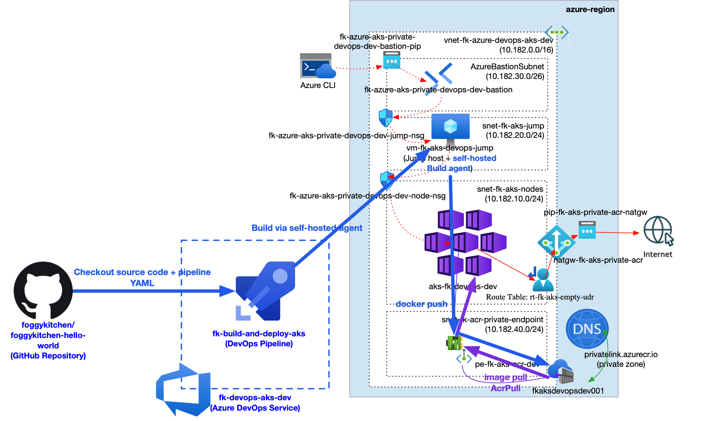
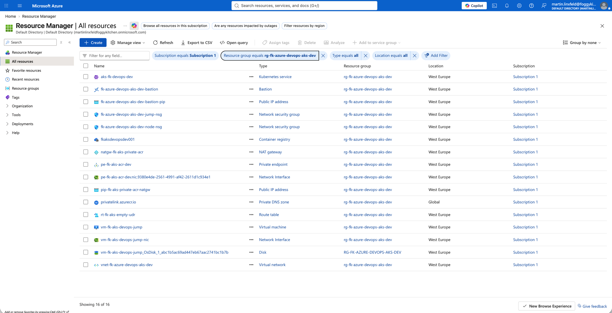
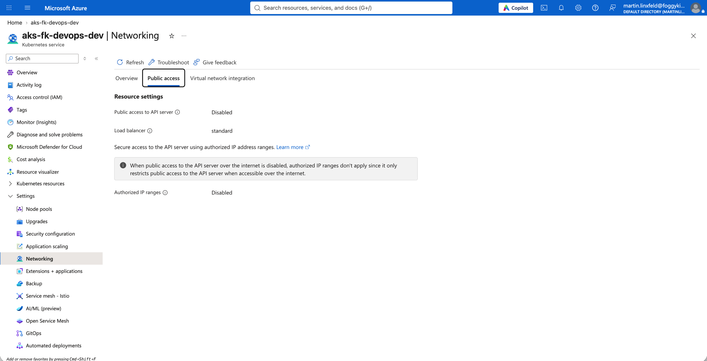
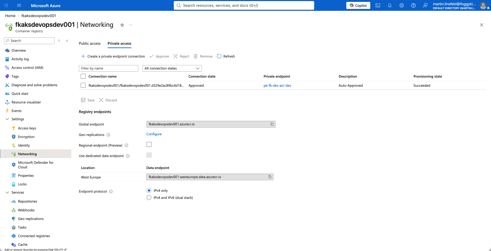
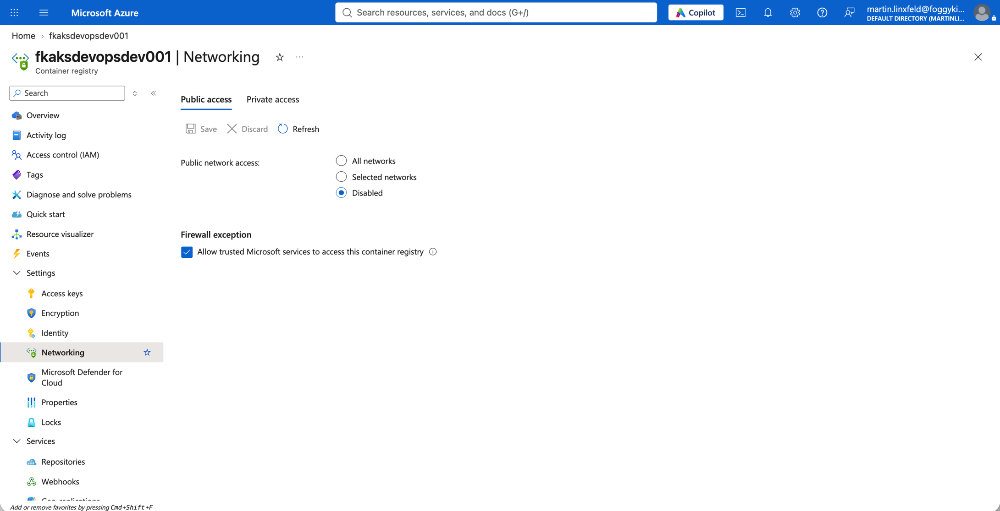
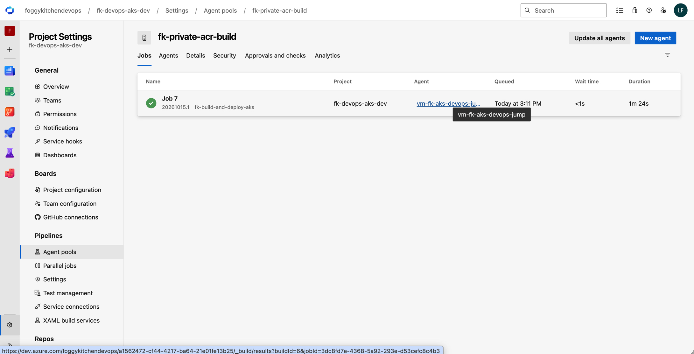
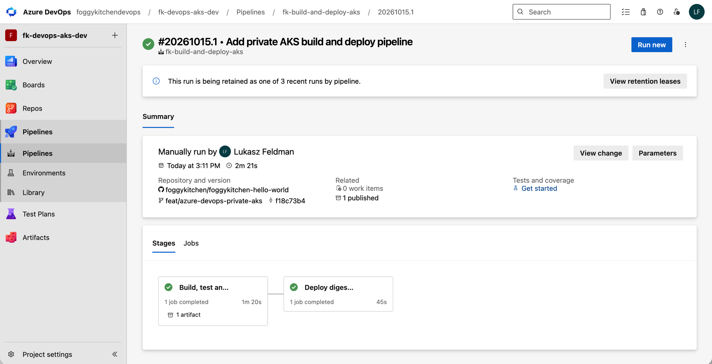
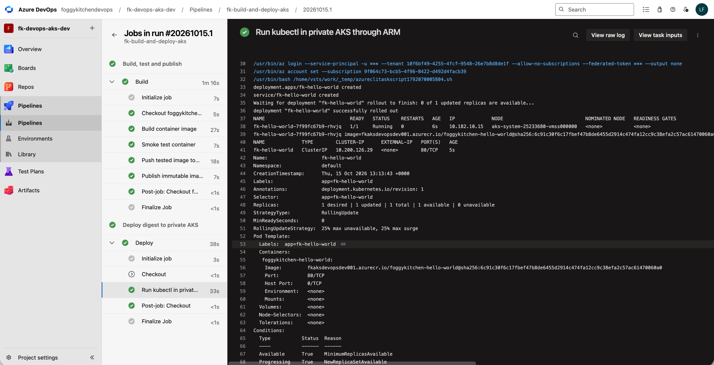

# Azure DevOps Build and Deploy Private AKS — Basic

This example provisions a private AKS + private Premium ACR baseline and an Azure DevOps pipeline that builds the demo app and deploys its immutable image digest. It uses the flat, self-contained [pattern](../../../../../patterns/azure/devops_build_and_deploy_aks/README.md).



## Prerequisites

- OpenTofu >= 1.6, Azure CLI login to the target tenant/subscription, permission to create resources, custom roles, and role assignments, plus Entra application creation rights.
- Azure DevOps organization and credentials with project, service connection, variable group, build definition, and pipeline permission management access.
- GitHub source endpoint credential with access to `foggykitchen/foggykitchen-hello-world`.
- The companion `azure-pipelines-cicd-aks.yml` must exist on the selected app branch before running the pipeline.
- Permission to create/manage Azure DevOps agent pools and project queues. Terraform creates the named pool and authorizes this pipeline. Use a new pool name, or import an existing pool.
- A short-lived PAT with **Agent Pools: Read & manage** from a pool administrator for the one-time interactive agent registration on the jump VM. Do not put this PAT in Terraform variables or cloud-init.
- Microsoft-hosted agent capacity for the Deploy job.

The example creates billable AKS nodes, Premium ACR, NAT Gateway, Bastion, a VM, and related networking. Keep it deployed only while needed.

## Configure and provision

```bash
cp terraform.tfvars.example terraform.tfvars
# Edit subscription_id, tenant_id, subscription_name, organization_url,
# build_agent_pool_name, and optionally admin_ssh_public_key.
# Edit landing-zone.yaml to choose a globally unique ACR name and region.
az login
# The Azure DevOps provider uses the Azure CLI session (use_cli = true).
# Supply AZDO_GITHUB_SERVICE_CONNECTION_PAT through your local secret
# manager/environment for the GitHub source endpoint; never commit it.
tofu init
tofu validate
tofu plan -out=deployment.tfplan
tofu apply deployment.tfplan
```

If `admin_ssh_public_key` is empty, the example generates an RSA-4096 key pair using the TLS provider, following the existing networking examples. The private key is stored in Terraform state and exposed only as the sensitive `generated_admin_ssh_private_key_pem` output; protect the state. To save it locally for Bastion SSH without printing it:

```bash
(umask 077; tofu output -raw generated_admin_ssh_private_key_pem > /private/tmp/fk-devops-aks-jump.pem)
```

The selected region must support the configured AKS version and VM SKU. The address plan uses `10.182.0.0/16` with distinct node, jump, Bastion and Private Endpoint subnets; the service CIDR is `10.200.0.0/16`. A `/24` node subnet provides room for this single-node Azure CNI demo and upgrade surge; revisit capacity before increasing node or pod counts.

The example reuses **`vm-fk-aks-devops-jump`** as both the jump host and Build agent, with `Standard_B2s` (2 vCPU, 4 GiB RAM). Cloud-init installs Docker, Azure CLI, kubectl and the Azure Pipelines agent. No separate Build VM is created.

After apply, connect with the Bastion SSH command from the `jump_host` output. On the VM run:

```bash
sudo cloud-init status --wait
sudo /usr/local/sbin/fk-register-build-agent
```

The helper asks interactively for the registration PAT, configures the agent for this organization/pool and installs/starts its systemd service as `azagent`. It can be rerun to start an already configured agent without registering a duplicate. Wait for the agent to appear Online in Azure DevOps before running the pipeline. The pipeline uses OIDC for Azure access; the registration PAT is only for attaching the agent to Azure DevOps. Docker group access gives Build tasks effective root privileges on the shared VM.

Check private ACR DNS and TCP 443 from this VM. The `build_agent` output supplies the pool name and registration command; `devops` identifies the project, pipeline, service principal and custom Run Command role.

## Run and verify

The payload defaults to `master`. Until the companion YAML is merged there, set `devops.github.branch` in `landing-zone.yaml` to `feat/azure-devops-private-aks` before provisioning. The selected branch must contain `azure-pipelines-cicd-aks.yml`.

Both YAML triggers are disabled so the first run is explicit (replace `PIPELINE_ID` with the current `devops` output; use `master` after merge):

```bash
az pipelines run --organization https://dev.azure.com/foggykitchendevops \
  --project fk-devops-aks-dev --id PIPELINE_ID --branch feat/azure-devops-private-aks
```

Build retains the existing demo pipeline's checkout, Docker build, smoke test, OIDC push and `IMAGE_METADATA` artifact steps, with the Build pool changed for private ACR connectivity. Deploy runs on Microsoft-hosted Ubuntu and invokes kubectl through ARM. It creates a Deployment and internal ClusterIP Service, waits for rollout, compares the configured digest reference, prints pod runtime `imageID` values, and fails if the remote command exit code is nonzero. It does not create an Internet-facing service.

For an independent check, use the actual image digest from the pipeline logs:

```bash
az aks command invoke --resource-group rg-fk-azure-devops-aks-dev \
  --name aks-fk-devops-dev \
  --command 'kubectl get pods -l app=fk-hello-world -o wide; kubectl describe deployment fk-hello-world; kubectl get service fk-hello-world'
```

A successful CLI call alone is insufficient: check Run Command's `exitCode`, rollout status, Deployment image digest and pod runtime image IDs. The custom Run Command role has now succeeded in the real OIDC pipeline. The live trials of Cluster User and RBAC Writer both failed as documented below; restoring the custom role passed the positive control.


## Verified results — 2026-10-15

The verification environment was destroyed after testing. Run links below identify the historical runs; the Azure DevOps project has since been deleted. Screenshots and command output preserve the results.

The example was applied to a real Azure subscription in West Europe:

```text
Plan: 48 to add, 0 to change, 0 to destroy.
Apply complete! Resources: 48 added, 0 changed, 0 destroyed.
```

The shared jump/Build VM completed cloud-init, Docker reported `active`, and the installed Azure Pipelines agent reported version `5.280.0`. From that VM, the private ACR resolved to `10.182.40.5`, and TCP 443 connectivity succeeded. The agent was registered using a short-lived Entra token over Bastion SSH and appeared **Online** in pool `fk-private-acr-build`; no registration token was placed in Terraform or cloud-init.

### Build, push and deployment

[Pipeline run 6](https://dev.azure.com/foggykitchendevops/fk-devops-aks-dev/_build/results?buildId=6) completed with **Build and Deploy both succeeded**. It used app commit [f18c73b](https://github.com/foggykitchen/foggykitchen-hello-world/commit/f18c73b) on branch `feat/azure-devops-private-aks`; the new YAML was not yet merged to `master` at verification time.

Actual task output included:

```text
Smoke test passed: NGINX serves the repository's index.html
6: digest: sha256:6c91c30f6c17fbef47b8de6455d2914c474fa12cc9c38efa2c57ac61470060a0 size: 3359
deployment.apps/fk-hello-world created
service/fk-hello-world created
deployment "fk-hello-world" successfully rolled out
```

The Microsoft-hosted Deploy job used `AzureCLI@2`, the `fk-azure-oidc` service connection, and this command with the YAML's multiline kubectl script:

```bash
az aks command invoke --resource-group "$RESOURCE_GROUP" --name "$AKS_CLUSTER" \
  --command "$command" --output json
```

The task checked remote `exitCode = 0`. Deployment used **plain kubectl**, without Helm or attached chart files. The working cluster-scoped role was **`fk-azure-devops-aks-dev AKS Run Command`**, containing cluster read, `runcommand/action`, and `commandResults/read`; `AcrPush` was assigned separately at ACR scope. The separate live trials of both built-in candidate roles are documented below.

The deployed pod was `1/1 Running` on `aks-system-25233680-vmss000000`, with pod IP `10.182.10.15`. Its configured image and runtime `imageID` both matched the pushed image:

```text
fkaksdevopsdev001.azurecr.io/foggykitchen-hello-world@sha256:6c91c30f6c17fbef47b8de6455d2914c474fa12cc9c38efa2c57ac61470060a0
```

The internal Service was `fk-hello-world`, type `ClusterIP`, address `10.200.126.29`, port `80/TCP`. A separate `az aks command invoke` check confirmed the same running pod, digest and Service with remote `exitCode: 0`.

### Live RBAC role trials — 2026-10-15

The two candidate roles were tested separately on pipeline service principal `ae7a005f-ddfe-47f8-8f9e-2995b2539abd`, using the same real YAML pipeline, `AzureCLI@2`, `fk-azure-oidc`, and Microsoft-hosted Deploy agent. Before each trial, the custom Run Command assignment was removed. Assignment snapshots confirmed only the candidate role at AKS scope and `AcrPush` at ACR scope; no inherited Run Command grant appeared in the identity's assignments. A fresh pipeline run was queued after a propagation pause.

| AKS role | Evidence | Build / push | Deploy | Observed result |
| --- | --- | --- | --- | --- |
| Azure Kubernetes Service Cluster User Role | [Run 7](https://dev.azure.com/foggykitchendevops/a1562472-cf44-4217-ba64-21e01fe13b25/_build/results?buildId=7) | succeeded | failed | `AuthorizationFailed`: `Microsoft.ContainerService/managedClusters/runCommand/action` |
| Azure Kubernetes Service RBAC Writer | [Run 8](https://dev.azure.com/foggykitchendevops/a1562472-cf44-4217-ba64-21e01fe13b25/_build/results?buildId=8) | succeeded | failed | `AuthorizationFailed`: `Microsoft.ContainerService/managedClusters/read` |
| fk-azure-devops-aks-dev AKS Run Command | [Run 9](https://dev.azure.com/foggykitchendevops/a1562472-cf44-4217-ba64-21e01fe13b25/_build/results?buildId=9) | succeeded | succeeded | Run Command and kubectl rollout succeeded |

The command under test was the actual Deploy task command:

```bash
az aks command invoke --resource-group "$RESOURCE_GROUP" --name "$AKS_CLUSTER" \
  --command "$command" --output json
```

`RESOURCE_GROUP=rg-fk-azure-devops-aks-dev`, `AKS_CLUSTER=aks-fk-devops-dev`; `$command` was the existing pipeline's kubectl deploy/rollout/inspection script. Both negative trials failed in ARM authorization before that remote script could execute. RBAC Writer failed earlier, at cluster read; it was not reported as a Kubernetes workload authorization failure.

**Run 7 — Azure Kubernetes Service Cluster User Role** (actual task output):

```text
2026-10-15T13:41:19.8391274Z ERROR: (AuthorizationFailed) The client '***' with object id 'ae7a005f-ddfe-47f8-8f9e-2995b2539abd' does not have authorization to perform action 'Microsoft.ContainerService/managedClusters/runCommand/action' over scope '/subscriptions/9f064c73-bcb5-4f96-8422-d492d4facb39/resourceGroups/rg-fk-azure-devops-aks-dev/providers/Microsoft.ContainerService/managedClusters/aks-fk-devops-dev' or the scope is invalid. If access was recently granted, please refresh your credentials.
```

**Run 8 — Azure Kubernetes Service RBAC Writer** (actual task output):

```text
2026-10-15T13:43:36.7889247Z ERROR: (AuthorizationFailed) The client '***' with object id 'ae7a005f-ddfe-47f8-8f9e-2995b2539abd' does not have authorization to perform action 'Microsoft.ContainerService/managedClusters/read' over scope '/subscriptions/9f064c73-bcb5-4f96-8422-d492d4facb39/resourceGroups/rg-fk-azure-devops-aks-dev/providers/Microsoft.ContainerService/managedClusters/aks-fk-devops-dev' or the scope is invalid. If access was recently granted, please refresh your credentials.
```

**Run 9 — restored custom role** (actual task output):

```text
2026-10-15T13:45:44.1436454Z deployment "fk-hello-world" successfully rolled out
2026-10-15T13:45:44.1481979Z fk-hello-world-7f99fc67b9-rhvjq image=fkaksdevopsdev001.azurecr.io/foggykitchen-hello-world@sha256:6c91c30f6c17fbef47b8de6455d2914c474fa12cc9c38efa2c57ac61470060a0 imageID=fkaksdevopsdev001.azurecr.io/foggykitchen-hello-world@sha256:6c91c30f6c17fbef47b8de6455d2914c474fa12cc9c38efa2c57ac61470060a0
```

**Confirmed working role:** `fk-azure-devops-aks-dev AKS Run Command`, assigned at this cluster only, with these management actions:

```text
Microsoft.ContainerService/managedClusters/read
Microsoft.ContainerService/managedClusters/runcommand/action
Microsoft.ContainerService/managedClusters/commandResults/read
```

The original custom assignment ID (`ff5f450f-21bb-7c37-a2b7-8aeef750fb86`) was restored and both temporary candidate assignments were deleted. A comparison of assignment IDs, principal IDs and role definition IDs before/after confirmed the original access was restored exactly. The positive-control run then passed both stages. These tests do not claim this is the only possible Azure role; they establish that the two requested built-in roles alone are insufficient, while this narrowly scoped custom role works. No additional cloud test is pending for these two candidates.

### Application access from the jump host

A direct HTTP request from the jump VM to `http://10.200.126.29/` timed out (`HTTP 000`). The ClusterIP is not a VNet-facing application endpoint. Application access from the jump host was verified using **port-forward through the private AKS API**.

With a temporary kubeconfig, the following commands ran on `vm-fk-aks-devops-jump` (keep port-forward running in one terminal and curl in another):

```bash
kubectl get deployment fk-hello-world
kubectl port-forward service/fk-hello-world --address 127.0.0.1 18080:80
curl --fail http://127.0.0.1:18080/
```

The Deployment reported `1/1` ready. The HTTP response contained the demo page (excerpt):

```html
<!DOCTYPE html>
<html>
  <head>
    <meta charset="UTF-8">
    <title>FOGGYKITCHEN.COM</title>
```

The downloaded page's SHA-256 matched the repository's `src/index.html`:

```text
0056c85f9198df94294e93d0561c43d3ed2dc4ab1f560e27a2cdc162adb1c4bb
```

The check exited `0` with `APPLICATION_REACHABLE_FROM_JUMP`. Temporary kubeconfig files and the test port-forward were removed afterwards. There is no public application URL, and the port-forward is not left running.

The verified command output and live RBAC trial results are recorded above.

## Screenshots

### Resource Group

Provisioned resources in the example resource group.



### Private AKS API

Public access to the AKS API server is disabled.



### ACR Private Endpoint

The ACR Private Endpoint connection is approved and provisioning succeeded.



### ACR public access

Public network access to ACR is disabled.



### Self-hosted Build agent

A successful Build job executed on vm-fk-aks-devops-jump in pool fk-private-acr-build. This capture shows the Jobs tab; live Online status was verified through the agent API.



### Pipeline run

The verified run completed both Build and Deploy successfully.



### Deploy logs

Run Command output shows a successful rollout, the running pod, ClusterIP Service and Deployment image digest.



Application access from the jump host is documented above with commands and test output; no additional terminal screenshot is required.

## Cleanup

```bash
tofu plan -destroy -out=destroy.tfplan
tofu apply destroy.tfplan
```

Before destroying, stop/uninstall the agent service and remove its registration on the VM with `/opt/azagent/svc.sh` and `/opt/azagent/config.sh remove` (run config.sh as `azagent`). Terraform removes the VM, project queue, pipeline authorization and pool.

### Verified teardown — 2026-10-15

The reviewed destroy plan contained only the 48 example-managed resources:

```text
Plan: 0 to add, 0 to change, 48 to destroy.
Apply complete! Resources: 0 added, 0 changed, 48 destroyed.
```

The saved destroy plan was applied with exit code 0. Follow-up checks confirmed:

```console
$ az group exists --name rg-fk-azure-devops-aks-dev
false
$ az group exists --name MC_rg-fk-azure-devops-aks-dev_aks-fk-devops-dev_westeurope
false
$ tofu state list
# empty; exit 0
```

Authenticated Azure DevOps GET requests for project `a1562472-cf44-4217-ba64-21e01fe13b25` and agent pool `11` each returned HTTP 404. The local Bastion tunnel was closed. Repository code and screenshots remain available.
