# Azure Multiregion Compute Failover Basic Example

This example composes a **stateless Azure multiregion compute failover** landing zone with Azure Front Door Standard, two independent regional public Load Balancers, and warm-standby VM Scale Set capacity.

It is the Azure counterpart to the OCI `multiregion_compute_failover` basic example. It keeps the same public/basic scope: stateless web failover only, no file replication, no database replication, and no private cross-region network dependency.

## Architecture Overview

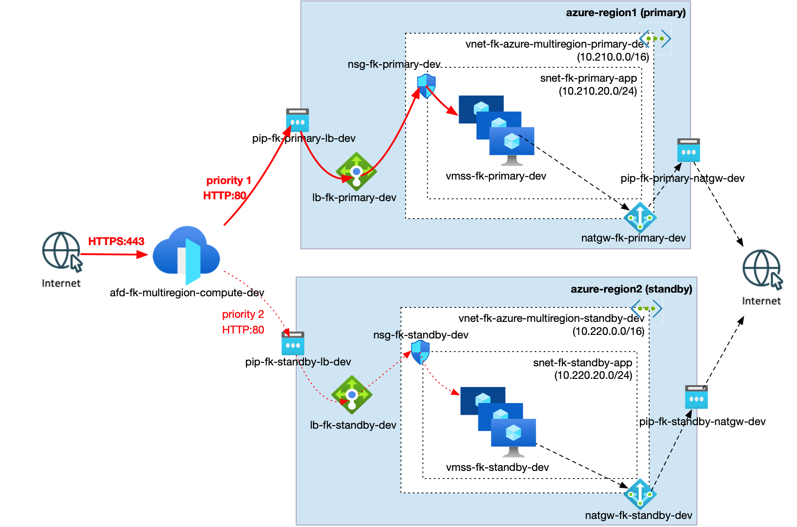

**Figure 1.** `multiregion_compute_failover` runtime model: a primary site and a standby site each expose a public Standard Load Balancer backed by a regional VM Scale Set. Azure Front Door Standard accepts HTTPS traffic at the edge and performs priority-based failover between the public regional HTTP origins.

## What This Example Deploys

- primary and standby Azure regions
- one Resource Group
- one independent VNet per region, each with one application subnet
- one NSG associated to each application subnet
- NAT Gateway egress for each private app subnet
- one public Standard Load Balancer per region
- one VM Scale Set per region
- Azure Front Door Standard priority-based failover across both regional public Load Balancer endpoints
- smaller standby capacity by default to model a lightweight warm standby

## Pattern

- [`patterns/azure/multiregion_compute_failover`](../../../../../patterns/azure/multiregion_compute_failover/README.md)

## Files

- [landing-zone.yaml](landing-zone.yaml)
- [main.tf](main.tf)
- [providers.tf](providers.tf)
- [variables.tf](variables.tf)
- [outputs.tf](outputs.tf)
- [terraform.tfvars.example](terraform.tfvars.example)

## Deploy

```bash
cp terraform.tfvars.example terraform.tfvars
tofu init
tofu validate
tofu plan
tofu apply
```

Replace the placeholder values in `terraform.tfvars` before planning.

## Validation Flow

After a manual apply, validate the pattern by:

1. opening `https://<frontdoor_failover.endpoint_host_name>`
2. confirming the page shows the primary site
3. stopping or scaling down the primary VM Scale Set instances
4. confirming Azure Front Door health probes mark the primary origin unhealthy
5. opening the same Front Door endpoint again and confirming the standby site responds

Expected result:

- Front Door serves the primary site while the primary origin is healthy
- Front Door fails over to the standby site when the primary origin becomes unhealthy
- both regional public Load Balancers show healthy backend pools before failover testing
- both VM Scale Sets are deployed with the expected primary and warm-standby capacity
- app subnet egress is provided by NAT Gateway in each region
- there is no cross-region VNet peering, VPN Gateway, file replication, or database replication

## Azure Portal Verification

Capture the following after a manual apply:

- `azure_multiregion_compute_failover_basic_resource_group.jpg` - Resource Group overview after deployment
- `azure_multiregion_compute_failover_basic_frontdoor_origins.jpg` - Azure Front Door origin group showing primary and standby origins
- `azure_multiregion_compute_failover_basic_frontdoor_route.jpg` - Azure Front Door route accepting HTTPS and forwarding to the origin group
- `azure_multiregion_compute_failover_basic_frontdoor_endpoint_primary.jpg` - Front Door endpoint serving the primary site
- `azure_multiregion_compute_failover_basic_frontdoor_endpoint_failover.jpg` - Front Door endpoint serving the standby site after primary origin failure
- `azure_multiregion_compute_failover_basic_primary_load_balancer_frontend.jpg` - primary regional Load Balancer frontend public IP
- `azure_multiregion_compute_failover_basic_primary_load_balancer_backend.jpg` - primary regional Load Balancer backend pool
- `azure_multiregion_compute_failover_basic_standby_load_balancer_frontend.jpg` - standby regional Load Balancer frontend public IP
- `azure_multiregion_compute_failover_basic_standby_load_balancer_backend.jpg` - standby regional Load Balancer backend pool
- `azure_multiregion_compute_failover_basic_primary_vmss.jpg` - primary VM Scale Set capacity
- `azure_multiregion_compute_failover_basic_standby_vmss.jpg` - standby VM Scale Set warm-standby capacity
- `azure_multiregion_compute_failover_basic_primary_vnet_subnets.jpg` - primary VNet application subnet
- `azure_multiregion_compute_failover_basic_standby_vnet_subnets.jpg` - standby VNet application subnet
- `azure_multiregion_compute_failover_basic_primary_nat_gateway.jpg` - primary NAT Gateway association
- `azure_multiregion_compute_failover_basic_standby_nat_gateway.jpg` - standby NAT Gateway association

## Deployment Evidence

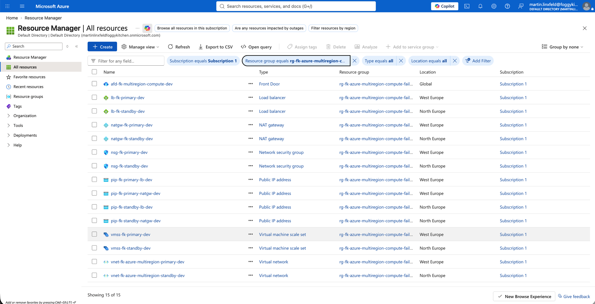

**Figure 2.** Resource Group overview after deployment, showing the Azure Front Door profile, regional public Load Balancers, VM Scale Sets, VNets, NAT Gateways, NSGs, public IPs, and supporting resources.

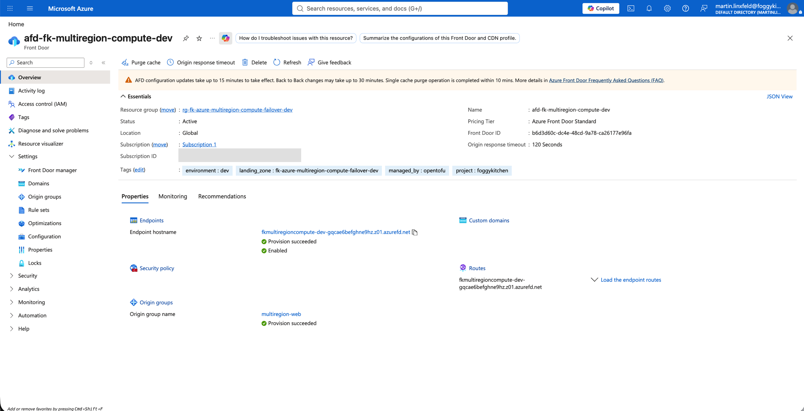

**Figure 3.** Azure Front Door Standard profile overview showing the enabled endpoint, succeeded provisioning state, origin group, and route.

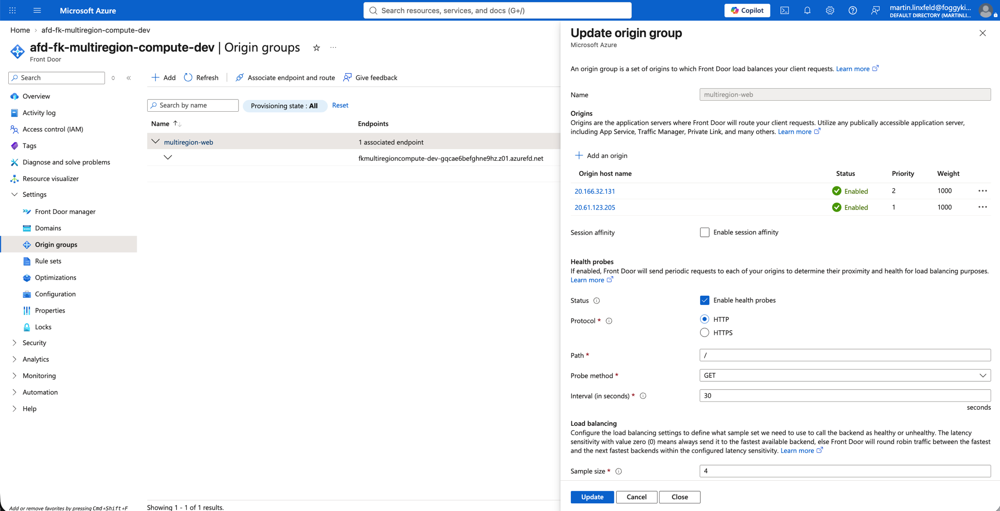

**Figure 4.** Front Door origin group `multiregion-web` with two enabled public Load Balancer origins: standby priority `2` and primary priority `1`.

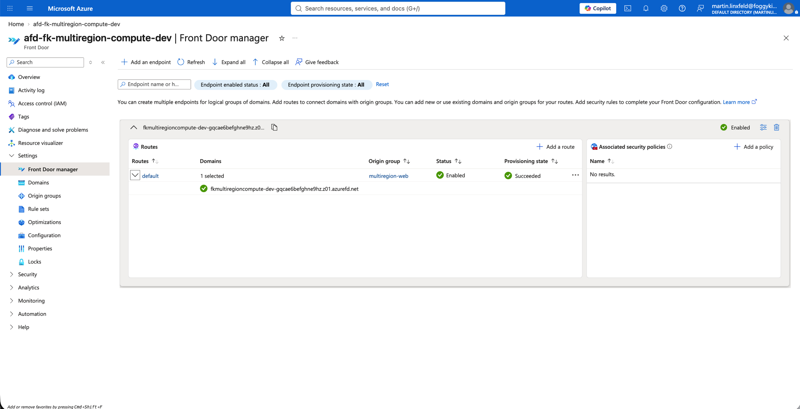

**Figure 5.** Front Door manager route view showing the `default` route associated with the `multiregion-web` origin group and the generated Azure Front Door endpoint host name.

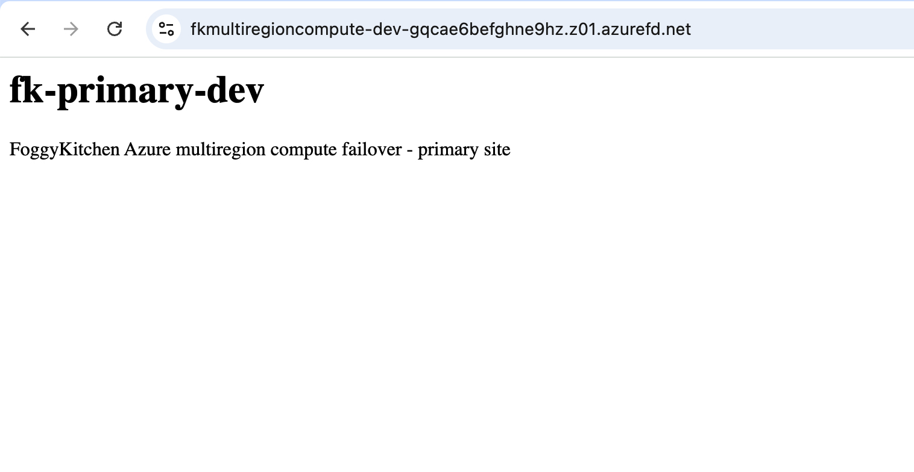

**Figure 6.** Front Door endpoint serving the primary site before failover, returning `fk-primary-dev`.

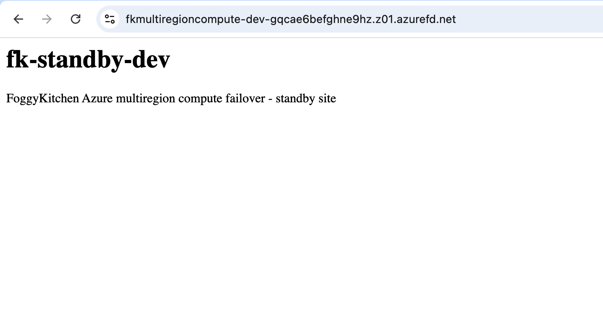

**Figure 7.** Front Door endpoint serving the standby site after the primary VM Scale Set was scaled to zero, returning `fk-standby-dev`.

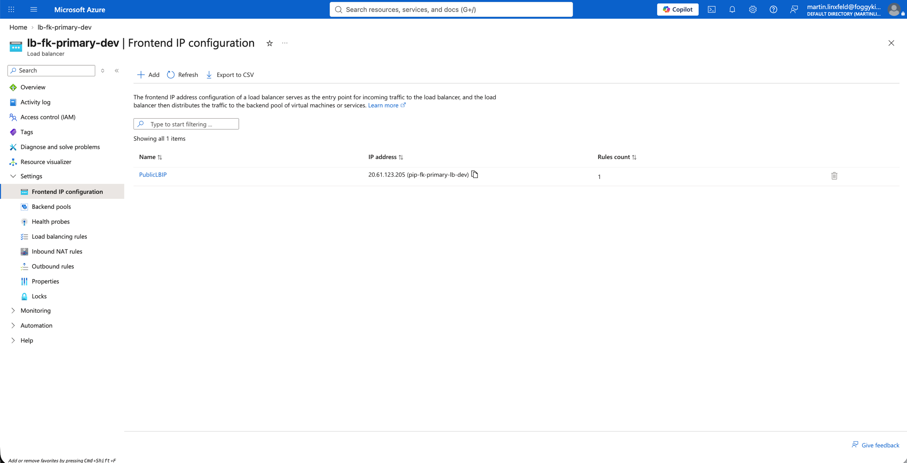

**Figure 8.** Primary regional public Load Balancer frontend configuration using `pip-fk-primary-lb-dev`.

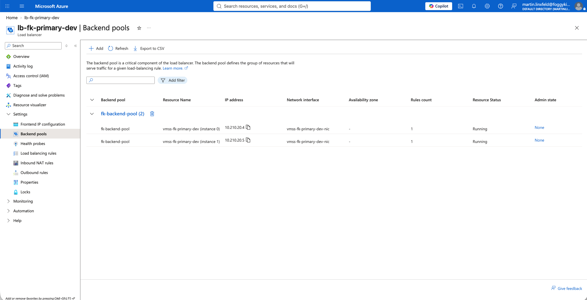

**Figure 9.** Primary regional Load Balancer backend pool with two running `vmss-fk-primary-dev` instances before failover.

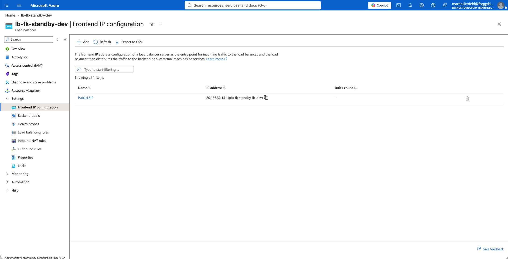

**Figure 10.** Standby regional public Load Balancer frontend configuration using `pip-fk-standby-lb-dev`.

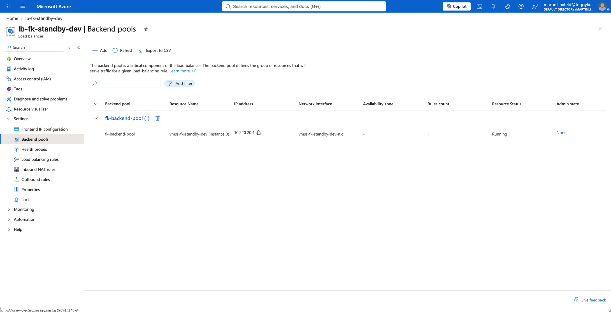

**Figure 11.** Standby regional Load Balancer backend pool with one running `vmss-fk-standby-dev` instance.

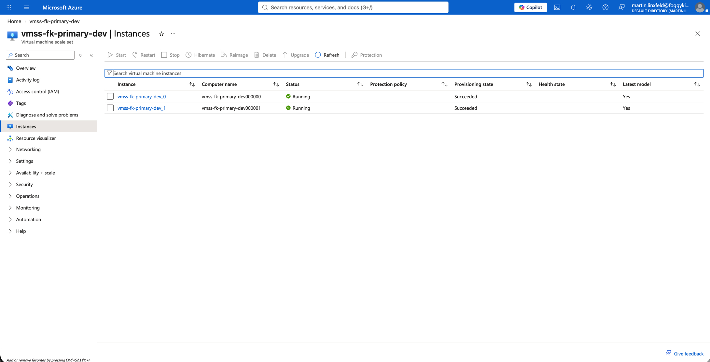

**Figure 12.** Primary VM Scale Set `vmss-fk-primary-dev` deployed in `westeurope` with two instances for the active site.


**Figure 13.** Standby VM Scale Set `vmss-fk-standby-dev` deployed in `northeurope` with one warm-standby instance.


**Figure 14.** Primary VNet subnet layout with one application subnet, `snet-fk-primary-app`.

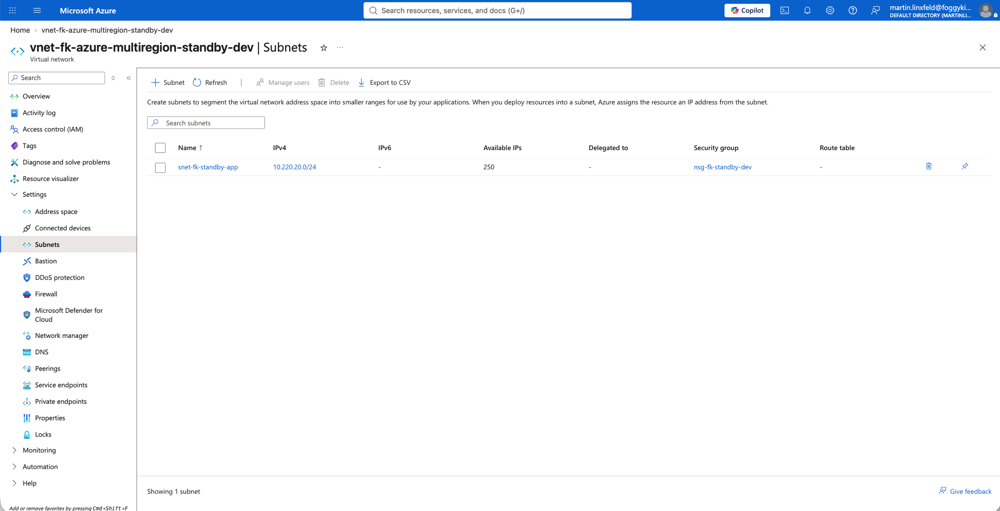

**Figure 15.** Standby VNet subnet layout with one application subnet, `snet-fk-standby-app`.

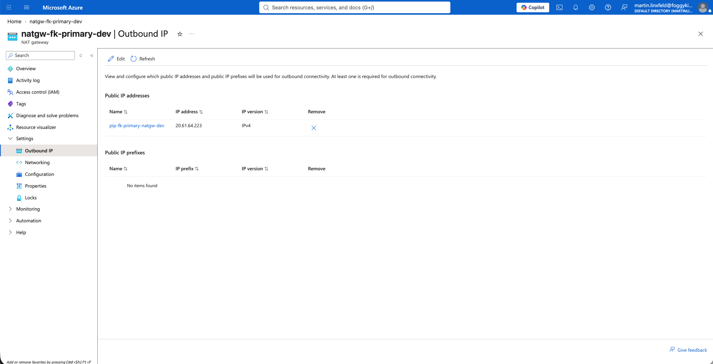

**Figure 16.** Primary NAT Gateway `natgw-fk-primary-dev` associated to the primary application subnet for outbound egress.

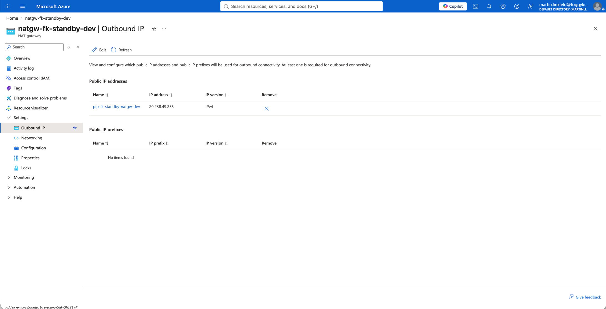

**Figure 17.** Standby NAT Gateway `natgw-fk-standby-dev` associated to the standby application subnet for outbound egress.

The failover test used the Azure Front Door endpoint from the `frontdoor_failover.endpoint_host_name` output. Before failover it returned `fk-primary-dev`. After scaling `vmss-fk-primary-dev` to capacity `0`, the same endpoint returned `fk-standby-dev`, confirming priority-based failover from the primary Load Balancer origin to the standby Load Balancer origin.

## Notes

- this public pattern focuses on stateless cross-region failover
- it intentionally excludes file replication and database replication
- it does not create cross-region VNet peering or VPN Gateway because Azure Front Door failover uses public regional origins, not private cross-region routing
- standby capacity is smaller by default to model a lightweight warm standby
- Azure Front Door WAF is intentionally not included in this parity port because the OCI basic pattern has no WAF-equivalent layer
- a future enterprise Azure multiregion pattern can add Front Door Premium Private Link origins, PostgreSQL read replicas, WAF, diagnostics, and governance in the private blueprint tier

## License

Licensed under the **Universal Permissive License (UPL), Version 1.0**.  
See [LICENSE](../../../../../LICENSE) for details.

© 2026 [FoggyKitchen.com](https://foggykitchen.com) - Cloud. Code. Clarity.
