# OCI BaseDB Private Access - Basic Example

Requires OCI provider **>= 9.12.1, < 10.0.0** and OpenTofu **>= 1.11.0**. See the [v2.0.0 migration guide](../../../../../../docs/oci-provider-9-migration.md).

A single private Oracle Base Database VM system with an OL9 validation host and OCI Bastion Service in an **existing compartment**. Available in orchestrator **v2.2.0**. Live deployment, access checks and cleanup are documented below.

## Architecture Overview

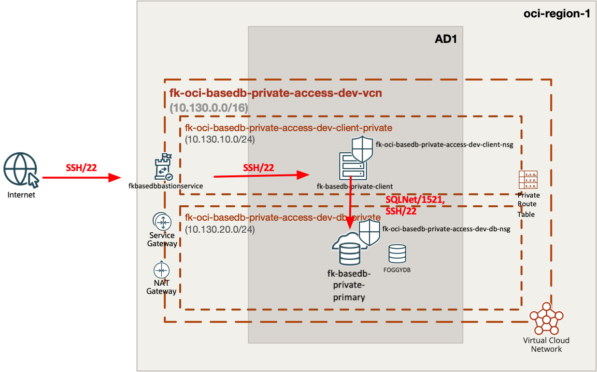

**Figure 1.** `basedb_private_access` composes one VCN with two private subnets, an NSG-protected BaseDB system and validation host, OCI Bastion Service, a NAT Gateway, and a Service Gateway. The diagram illustrates the architecture deployed during the live validation below.

## What This Example Deploys

- one VCN with two private regional subnets
- one PRIMARY BaseDB VM system with Standard Edition, 4 ECPUs and 256 GB data storage
- one private Oracle Linux 9 validation host with the Bastion agent plugin enabled
- separate database and client NSGs, with minimal subnet security lists
- one OCI Bastion Service and an optional Managed SSH session to the validation host
- one NAT Gateway, one Service Gateway and a shared private route table

The example uses an existing compartment and creates no Internet Gateway.

### Network Access

The NAT Gateway owns an egress address; neither workload has a public IP. Both private subnets exclude the default security list. The DB list is empty; the client list permits only Bastion endpoint egress to client TCP/22 and DB TCP/1521. NSGs control all workload ingress and remaining workload egress. Security-list grants are additive to NSGs and apply to every VNIC in the client subnet, so the client also receives these two narrow egress permissions. A dedicated third endpoint subnet would separate that policy but is outside this two-subnet design. The narrowly scoped client security-list egress is required by the service-managed Bastion endpoint, as described in [Oracle Bastion network setup](https://docs.oracle.com/en-us/iaas/Content/ContEng/Tasks/contengsettingupbastion.htm). OCI link-local DNS is used; resolving a name does not prove listener or SQL authentication success.

| Source | Destination | Protocol | Route / control |
| --- | --- | --- | --- |
| Operator allow-listed CIDR | Bastion service | SSH/22 | Bastion allow list and IAM |
| Bastion endpoint in client subnet | Client host | TCP/22 | Local VCN, client NSG |
| Client subnet, including Bastion endpoint | BaseDB subnet | TCP/22, TCP/1521 | Local VCN, DB NSG |
| Client | Internet package repositories | TCP/443 | NAT, client NSG |
| Database | Regional OSN services | TCP/443 | SGW, DB NSG service CIDR |
| VCN | Client/database | ICMP 3/4 | PMTUD, restricted to VCN CIDR |

Rules are stateful; response traffic uses state tracking. No public ingress is allowed. PMTUD from routers outside the VCN is not explicitly permitted; investigate MTU-related failures during live validation without broadly opening ingress. Database Internet HTTPS egress is intentionally absent; add only a reviewed destination if a future operation needs it.

## Pattern

- [`patterns/oci/basedb_private_access`](../../../../../../patterns/oci/basedb_private_access/README.md)
- [Payload contract](../../../../../../docs/payload-contract.md#oci-basedb-private-access)

## Files

- [landing-zone.yaml](landing-zone.yaml)
- [main.tf](main.tf)
- [providers.tf](providers.tf)
- [variables.tf](variables.tf)
- [versions.tf](versions.tf)
- [outputs.tf](outputs.tf)
- [terraform.tfvars.example](terraform.tfvars.example)
- [tests/oci9.tftest.hcl](tests/oci9.tftest.hcl)

## Requirements

- OpenTofu >= 1.11.0, OCI provider >= 9.12.1 and < 10.0.0; Git, OCI CLI, OpenSSH and jq.
- Existing tenancy, subscribed workload region and compartment. This example creates neither IAM policy nor a compartment.
- Operator IAM permissions to manage the scoped virtual network, compute and volumes, `database-family`, `bastion-family`, and to inspect/read images and availability domains. Session users need permission to use the bastion/manage its sessions and read target instance, VNIC and Oracle Cloud Agent plugin information. Have the tenancy administrator grant the required scope; consult [Bastion IAM](https://docs.oracle.com/en-us/iaas/Content/Identity/Reference/bastionpolicyreference.htm) and [Database IAM](https://docs.oracle.com/en-us/iaas/Content/Identity/Reference/databasepolicyreference.htm).
- Available BaseDB ECPU/service limits, 4 ECPUs and sufficient storage, plus capacity for VM.Standard.E5.Flex (1 OCPU/8 GB) and Bastion sessions.
- Verify **23.26.4.0.0** availability for VM.BaseDB.x86, Standard Edition and the selected AD/region. `database_version` is required and has no default. Override `data.basedb.availability_domain` if the first AD has insufficient capacity.
- OL9 image supporting Oracle Cloud Agent and its Bastion plugin. NAT/SGW HTTPS egress must work. Terraform waits 600 seconds after the host is created; actual plugin readiness still needs verification.

[BaseDB v0.1.0 example 01](https://github.com/foggykitchen/terraform-oci-fk-basedb/tree/v0.1.0/examples/01_single_primary) recorded a live deployment on 2026-11-09 with VM.BaseDB.x86, ECPU 4, 256 GB, 23.26.4.0.0, STANDARD_EDITION, LVM and listener 1521. That evidence belongs to the upstream public-bastion example, **not this new Bastion Service composition**. Live validation of this composition is recorded below; console screenshots are included below.

The pinned module sets LVM internally for ECPU. It exposes no storage-management input; do not add a fictitious `storage_management` argument. `oci.target` is explicitly mapped to the same provider as `oci` for target database/node discovery.

## Costs

**BaseDB has no Free Tier.** The baseline requests **4 ECPUs with LICENSE_INCLUDED**, 256 GB data storage plus system/recovery storage, and a paid compute host. Charges begin when resources are provisioned. NAT, storage and applicable network usage add costs. Automatic database backup is disabled by default; this is not a production backup policy. Provisioning and deletion may take tens of minutes. Review current regional pricing and limits before approving deployment.

## Deploy

```bash
cp terraform.tfvars.example terraform.tfvars
# Edit the placeholders for your existing compartment, API key and region.
export TF_VAR_database_version='23.26.4.0.0' # verify region availability
# Remove the database_version placeholder in terraform.tfvars if using TF_VAR_database_version.
read -r -s -p 'BaseDB SYS password: ' TF_VAR_basedb_admin_password; echo
export TF_VAR_basedb_admin_password
read -r -p 'Trusted operator public IPv4 CIDR (prefer /32): ' TF_VAR_operator_client_cidr
export TF_VAR_operator_client_cidr
tofu init
tofu plan
# Review the plan and billable resources before proceeding.
tofu apply
```

The `read -p` examples use Bash. Password and operator CIDR must come from runtime variables, not committed YAML/tfvars. Use the public egress address seen by Bastion (consider corporate VPN/NAT). `0.0.0.0/0`, invalid CIDRs and other /0 forms are rejected. Choose non-overlapping subnet CIDRs contained by the VCN if changing the example address plan.

`admin_ssh_public_key = ""` generates a lab RSA-4096 key. Supply an existing public key to avoid generating one. The same key reaches the validation host, BaseDB and Bastion session. `workload.client.cloud_init_override` replaces the default cloud-init; preserve installation of `nmap-ncat` and `bind-utils` if you need the documented checks.

## Validation Flow

After apply, connect through OCI Bastion Service and validate private SQL*Net reachability.

### Managed SSH

`access.bastion.create_session: true` creates one MANAGED_SSH session to the client after the readiness wait. Its default TTL is 3600 seconds (allowed 1800–10800). With `create_session: false`, the bastion is created but session outputs are null. A wait does not guarantee agent readiness; if session creation fails, inspect Oracle Cloud Agent/Bastion plugin status before retrying.

If a lab SSH key was generated, save it **outside the repository**:

```bash
umask 077
ssh_key="$HOME/.ssh/fk-basedb-lab.pem"
tofu output -raw generated_admin_ssh_private_key_pem > "$ssh_key"
ssh-keygen -y -f "$ssh_key" > "$ssh_key.pub"
# With an existing key, set ssh_key to its private-key path instead.
tofu output -json bastion | jq -r '.session_ssh_command'
```

Use the returned command, replacing its private-key placeholder in both the outer SSH and ProxyCommand. Do not copy your private key onto the VM. If the command output is null, fetch SSH metadata with `oci bastion session get --session-id SESSION_OCID` and check session lifecycle state. Review commands before running them.

On the client host:

```bash
sudo cloud-init status --wait
cat /opt/fk-basedb-private/README.txt
nc -vz <db-private-ip-from-output> 1521
```

The exact check is also in `tofu output -json validation_host | jq -r '.nc_validation'`. Optional Oracle Instant Client SQL*Plus can connect to the PDB service from `connection_strings`; enter credentials interactively. Local OS-authenticated SQL on a DB node and TCP listener reachability do not prove password-based application authentication.

Sessions expire. To renew the Terraform-managed session, review `tofu plan -replace='module.landing_zone.module.bastion.oci_bastion_session.this[0]'`, then apply that reviewed replacement only with approval. Do not replace the VM to renew a session.

### Manual Port Forwarding to BaseDB TCP/1521

Terraform intentionally creates no second session. After deployment, use the same public key to create a separate temporary forwarding session:

```bash
bastion_id=$(tofu output -json bastion | jq -r '.bastion_id')
db_ip=$(tofu output -json basedb_private_access | jq -r '.private_ips[0]')
pf_session_id=$(oci bastion session create-port-forwarding \
  --bastion-id "$bastion_id" \
  --target-private-ip "$db_ip" \
  --target-port 1521 \
  --ssh-public-key-file "$ssh_key.pub" \
  --session-ttl 3600 \
  --display-name fk-basedb-sqlnet \
  --query 'data.id' --raw-output)
oci bastion session get --session-id "$pf_session_id" \
  --query 'data."ssh-metadata"' --output json
```

Wait for the session to become ACTIVE, then use its SSH command, replacing the local-port placeholder with **11521** and the private-key placeholder with your key path. Keep the SSH tunnel running in a separate terminal. Do not use a public DB IP. The database NSG already allows 1521 from the subnet hosting the Bastion private endpoint.

```bash
nc -vz 127.0.0.1 11521
# Use the actual PDB service name reported in connection_strings:
sqlplus /nolog
# In SQL*Plus (password prompt follows):
# connect system@//127.0.0.1:11521/<PDB_SERVICE_NAME>
```

A successful local `nc` can only establish the SSH tunnel listener; confirm the remote path with the host-side `nc` and an actual SQL connection. See [Oracle CLI forwarding reference](https://docs.oracle.com/en-us/iaas/tools/oci-cli/latest/oci_cli_docs/cmdref/bastion/session/create-port-forwarding.html).

## Validation Result

Offline verification results are recorded in [the validation report](../../../../../../docs/pr-basedb-private-access.md). Tests explicitly use `command = plan` with mocked OCI, TLS and time providers; they do not create infrastructure or sleep for 600 seconds. The live checks below supplement these mocked tests; SQL authentication remains unverified.

### Live Validation — 2026-11-21

Deployed in `eu-frankfurt-1` with VM.BaseDB.x86, 4 ECPUs, 256 GB, STANDARD_EDITION, LICENSE_INCLUDED and database version `23.26.4.0.0`. BaseDB creation completed in **42 minutes 10 seconds**. The initial plan contained 26 resources; a follow-up apply created the one remaining Managed SSH session without changing or destroying existing resources.

| Check | Result |
| --- | --- |
| BaseDB provisioning | PASS; private IP `10.130.20.59` |
| Validation host | RUNNING; private IP `10.130.10.28`, no public IP |
| Bastion Service | ACTIVE; `fkbasedbbastionservice`, endpoint `10.130.10.82` |
| Managed SSH to validation host | PASS after session retry |
| Package installation | PASS after retrying `dnf install nmap-ncat bind-utils` |
| Host-to-database TCP/1521 | PASS with `nc -vz -w 10 10.130.20.59 1521` |
| SQL authentication / query | Not tested |
| Manual port forwarding | Not tested |
| Destroy | PASS on 2026-11-21; 26 resources destroyed, zero managed resources remaining in state |

The operator connected to the private validation host using the Managed SSH session, then ran `nc -vz -w 10 10.130.20.59 1521`. The connection succeeded in 0.01 seconds, confirming TCP/1521 reachability from the client subnet to BaseDB. The recorded output was:

```text
Ncat: Connected to 10.130.20.59:1521.
Ncat: 0 bytes sent, 0 bytes received in 0.01 seconds.
```

Two first-boot limitations were observed. The fixed 600-second wait was insufficient for Bastion plugin readiness: OCI rejected the first Managed SSH session request. After the plugin reported RUNNING, a new plan contained only the missing session and apply succeeded. Also, cloud-init could not reach `yum.oracle.com` during its initial package installation. Retrying the package installation over Managed SSH succeeded without changing network rules. This repaired the packages but does not erase the initial cloud-init error. A fresh deployment may need these retries; automatic readiness polling and resilient package installation remain follow-up improvements.

The TCP check confirms listener-port reachability from the private validation host, not database authentication. Live logs and saved plans are local ignored artifacts and must not be committed. Console evidence from this deployment is shown below.

## OCI Console Verification

Captured during live validation on 2026-11-21. Session states reflect the capture time; Bastion sessions expire according to their TTL.

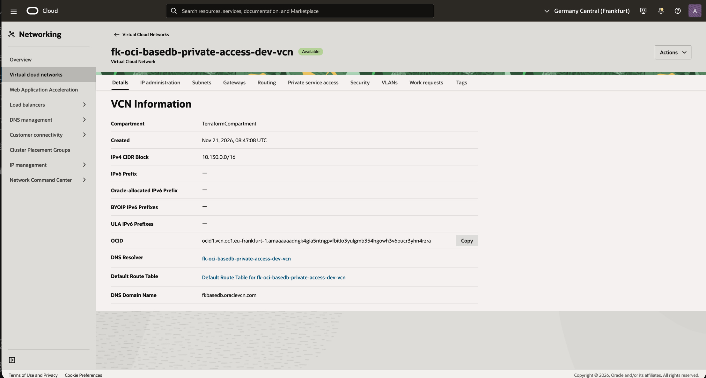

**Figure 2.** VCN `fk-oci-basedb-private-access-dev-vcn` is Available with CIDR `10.130.0.0/16`.

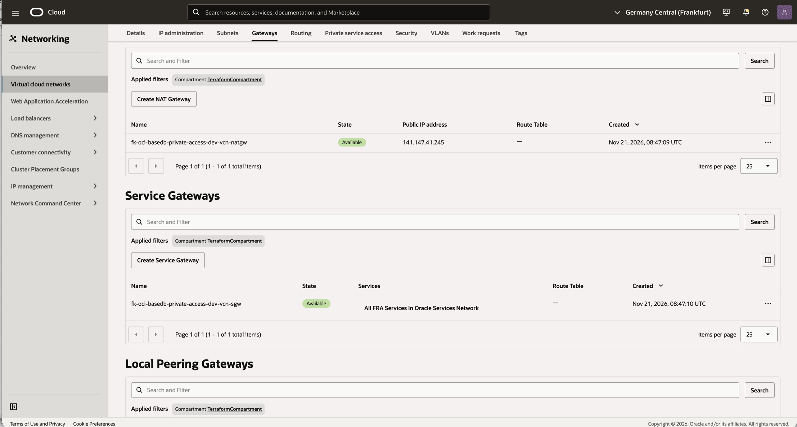

**Figure 3.** NAT Gateway and Service Gateway are Available; the service gateway targets all regional Oracle Services Network services.

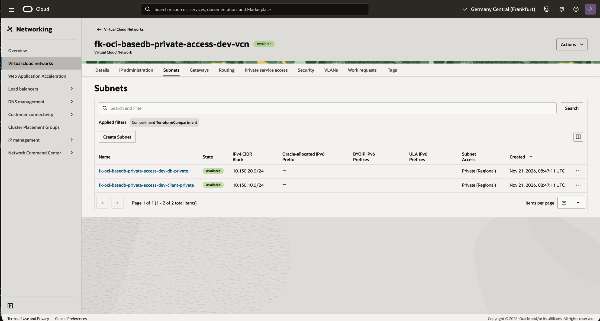

**Figure 4.** Both regional subnets are private: client `10.130.10.0/24` and database `10.130.20.0/24`.

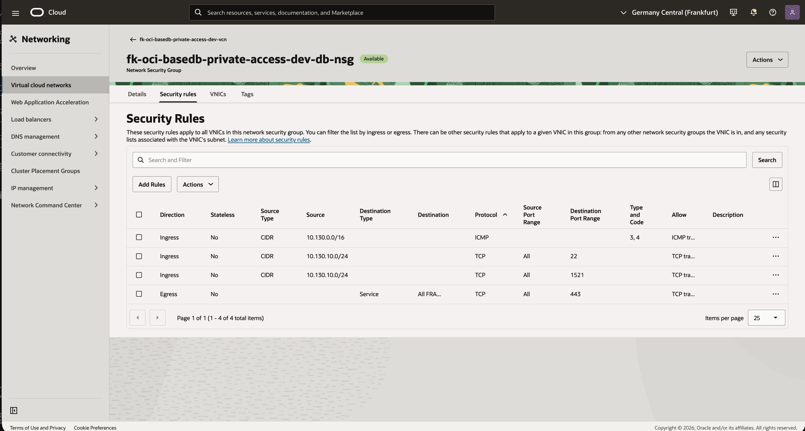

**Figure 5.** The database NSG permits TCP/22 and TCP/1521 from the client subnet, ICMP type 3/code 4 from the VCN, and outbound TCP/443 to regional OCI services.

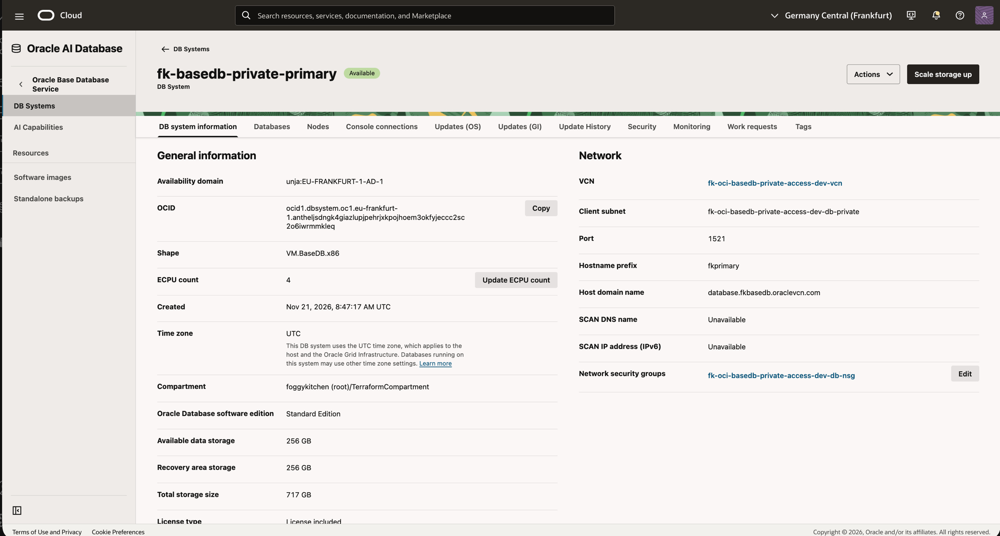

**Figure 6.** BaseDB is Available with VM.BaseDB.x86, 4 ECPUs, Standard Edition and 256 GB available data storage. Recovery and system storage increase total allocated storage.

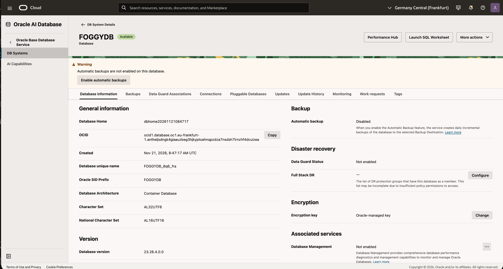

**Figure 7.** `FOGGYDB` is Available on version `23.26.4.0.0`; automatic backups and Data Guard are disabled for this lab.

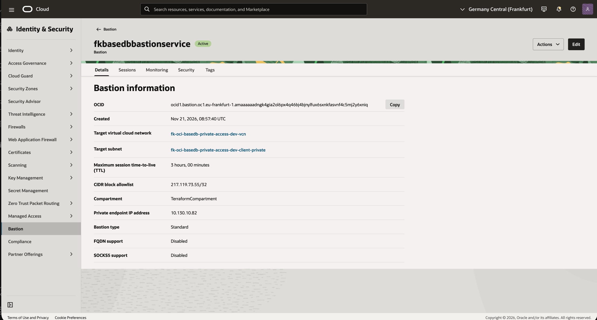

**Figure 8.** Bastion `fkbasedbbastionservice` is Active with a private endpoint in the client subnet.

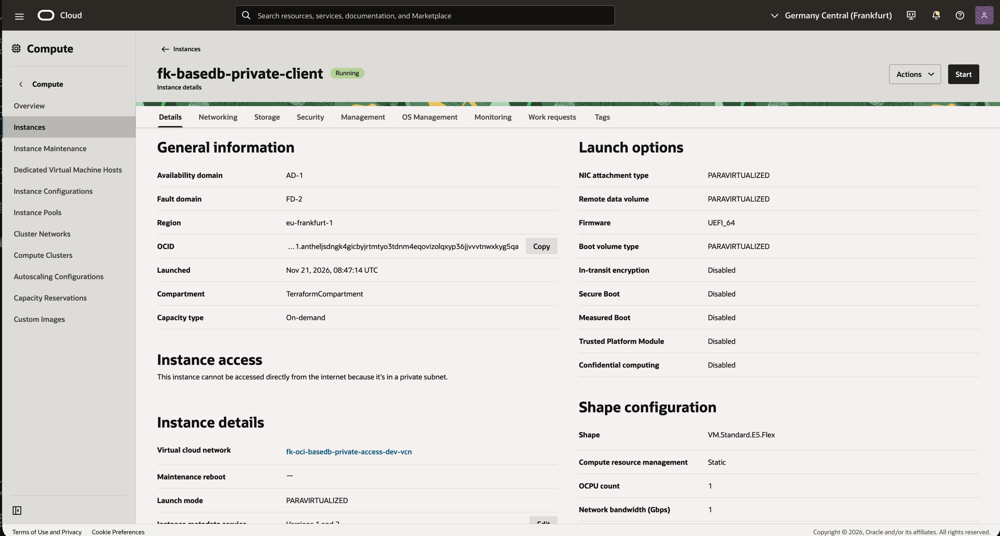

**Figure 9.** The validation host is Running on VM.Standard.E5.Flex with 1 OCPU in a private subnet.

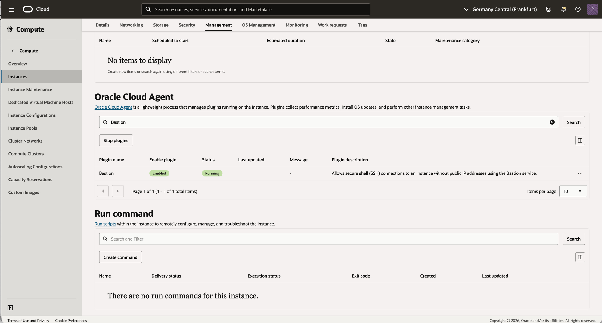

**Figure 10.** The Oracle Cloud Agent Bastion plugin is Enabled and Running.

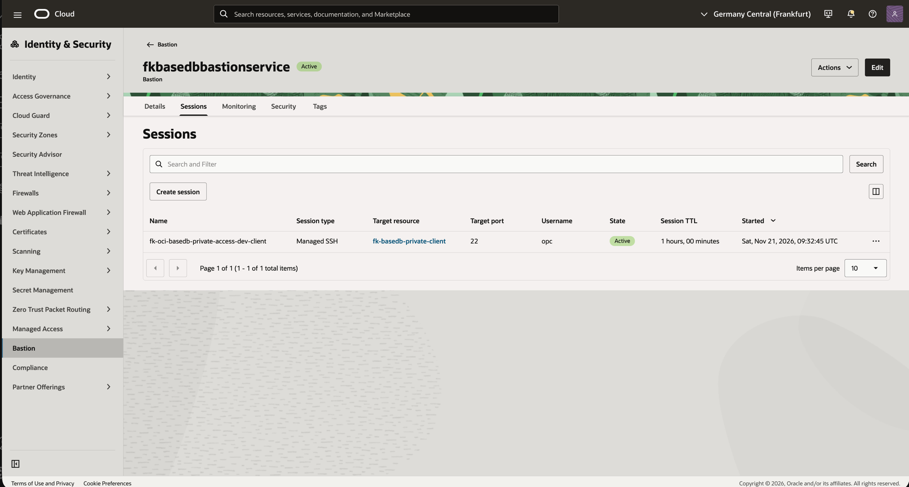

**Figure 11.** The Managed SSH session is Active, targets the validation host on TCP/22 as `opc`, and has a one-hour TTL at the time of capture.

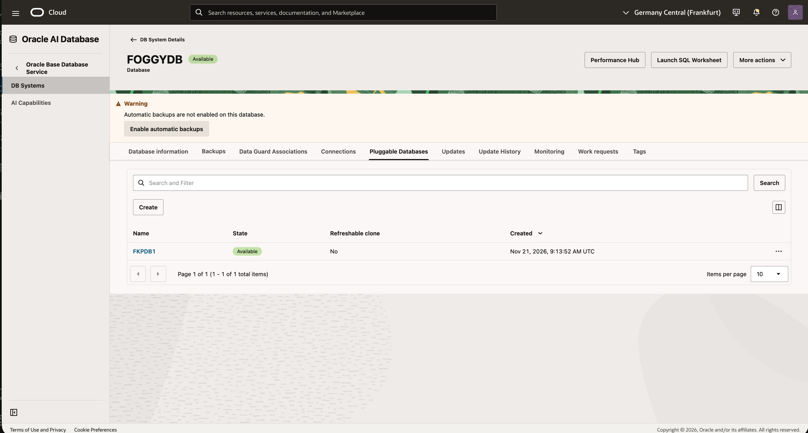

**Figure 12.** Pluggable database `FKPDB1` is Available within `FOGGYDB`.

## Destroy

After deployment, remove any manual forwarding sessions before destroying the Terraform-managed bastion. Protect required database data first.

```bash
oci bastion session delete --session-id "$pf_session_id" --force
tofu plan -destroy
tofu destroy
unset TF_VAR_basedb_admin_password TF_VAR_operator_client_cidr
```

Destroy deletes the database and lab data, compute and networking. The existing compartment is retained because this pattern does not manage it. Check for any remaining backups, volumes and manual sessions. User-approved cleanup completed on 2026-11-21 using a saved destroy plan: 0 added, 0 changed, 26 destroyed. The final OpenTofu state contains no managed resources; OCI reported the DB System as TERMINATED. The existing compartment was retained.

## Notes

### Security

The SYS password is sensitive, validated for length 12–30, and checked for complexity by OCI. It is still stored in state and saved plans. Use an encrypted backend with strict access controls and locking. Generated SSH private keys are also in state and the sensitive `generated_admin_ssh_private_key_pem` output. IDs, private IPs and password-free connection strings are operational outputs, not credentials. Never publish state, saved plans, private keys, credentials or real operator CIDRs.

### Next Steps

Same-region Data Guard, then cross-region Data Guard, will be separate orchestrator steps followed by blueprint compositions. They require a supported Enterprise Edition and a separate licensing, network and live compatibility review; do not enable Data Guard on this Standard Edition baseline by changing `role`.

## License

Licensed under the **Universal Permissive License (UPL), Version 1.0**.
See [LICENSE](../../../../../../LICENSE) for details.

© 2026 [FoggyKitchen.com](https://foggykitchen.com) - Cloud. Code. Clarity.
